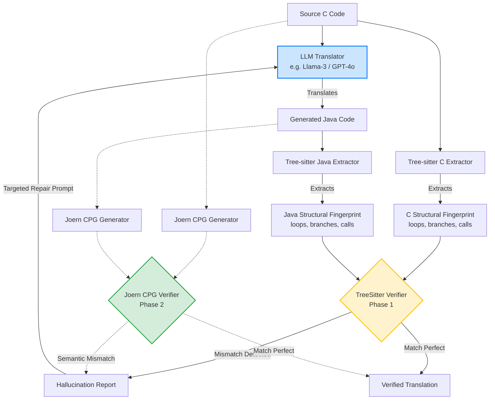

# NeuroAST: Architecture & Novelty

This document serves to align the AI agent and the researcher on the exact academic contribution and system architecture for the ICSE/ASE/FSE submission.

## 1. The Novelty (Academic Contribution)

**The Problem:** Existing Neuro-Symbolic code translation papers (like *AlphaTrans* or *CoTran*) rely on heavy, whole-program analysis, compiler feedback, or symbolic execution. These are slow, language-specific, and overkill for catching standard LLM "silent hallucinations" (like dropping a loop or hallucinating a branch).

**The NeuroAST Novelty:** 
> "NeuroAST introduces a **progressive, two-phase structural verification pipeline** for LLM-based legacy migration (C→Java). Instead of relying on expensive compiler feedback, NeuroAST uses a lightweight `tree-sitter` structural matcher (Phase 1) and a semantic `Joern CPG` matcher (Phase 2) as deterministic mathematical referees. This allows for fine-grained, interpretable hallucination taxonomy reporting and targeted localized repair loops, achieving high structural fidelity with minimal overhead."

## 2. System Architecture Diagram

This is the exact pipeline the agent is building in `src/neuroast/`:

## 3. How the Agent is Proceeding

The agent is **not** building a standard web app or basic script. The agent is building a **research framework**. 
1. `src/neuroast/verification/structures.py` defines the mathematical representation of `CFG_C` and `CFG_Java`.
2. `src/neuroast/verification/base.py` defines the abstract base class for `V1` and `V2` so they can be easily swapped for ablation studies.
3. The LLM integration (`litellm`) will only be used to generate the translation and apply the repair loop.
