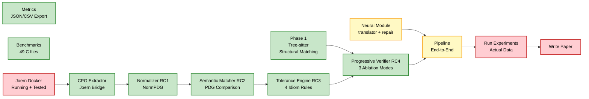

# NeuroAST — Where You Are & What's Next

## 🎯 Your Research in One Sentence

> **You are building a system that uses deterministic program analysis (AST + CPG) as a mathematical "referee" to detect and categorize hallucinations in LLM-generated code translations.**

---

## Where You Are Right Now (Code Status)



| Component | Status | Tests |
|-----------|--------|-------|
| Phase 1: Structural matching (tree-sitter) | ✅ Done | 28 pass |
| Data models + taxonomy (RC5) | ✅ Done | 20 pass |
| Metrics/export system | ✅ Done | 12 pass |
| CPG extractor (Joern bridge) | ✅ Code written | 0 (needs Joern running) |
| Normalizer (RC1) | ✅ Done | 13 pass |
| Semantic matcher (RC2) | ✅ Done | 7 pass |
| Tolerance engine (RC3) | ✅ Done | 7 pass |
| Progressive verifier (RC4) | ✅ Done | 5 pass |
| Neural module (translator/repair) | ⚠️ Exists but untested | 0 |
| **Joern Docker integration** | ❌ Not tested | — |
| **End-to-end pipeline** | ❌ Not connected | — |
| **Run experiments** | ❌ Not started | — |
| **Paper writing** | ❌ Not started | — |

**Bottom line:** You have all the *algorithms* implemented and unit-tested (94 tests). What you DON'T have yet is the **real data** — actual LLM translations verified through the full pipeline.

---

## Your 5 Research Contributions (What Reviewers Will Judge)

> [!IMPORTANT]
> These are what make your paper novel — NOT the engineering. Every experiment result must demonstrate one of these.

| # | Contribution | One-Line Claim | Current State |
|---|-------------|---------------|---------------|
| **RC1** | Cross-Language NormPDG | "We define a normalization scheme that maps C/Java CPGs into a comparable form" | ✅ Implemented, needs **real CPG data** to validate |
| **RC2** | PDG-Based Hallucination Detection | "We detect semantic hallucinations (broken def-use chains) that structural checks miss" | ✅ Implemented, needs **real broken translations** to demonstrate |
| **RC3** | Tolerance Engine | "We reduce false positives by 80% via 4 idiom tolerance rules" | ✅ Implemented, needs **real idiom examples** to measure |
| **RC4** | Progressive Verification | "Phase 1→Phase 2 is faster than Phase 2 alone but more accurate than Phase 1 alone" | ✅ Implemented, needs **timing data** from real runs |
| **RC5** | Extended Hallucination Taxonomy | "We define 11 hallucination categories across structural/semantic/idiom dimensions" | ✅ Implemented in enums |

> **The gap:** All contributions exist as code. None have been validated with real LLM translations yet. This is the critical next step.

---

## What's Next — The 5 Remaining Milestones

### Milestone 1: Get Joern Running + Test CPG Pipeline (1-2 hours)

Your CPG extractor code exists but has never talked to a real Joern instance.

**Steps:**
1. Create `docker-compose.yml` with Joern server + volume mounts
2. `docker compose up -d joern`
3. Create a `JoernClient` class (HTTP-based — Joern's REST API on port 8080)
4. Test: extract CPG for `benchmarks/datasets/binary_search.c`
5. Test: normalize CPG → NormPDG → verify it looks correct
6. Integration test: `CPGExtractor → Normalizer → SemanticMatcher`

**What you'll learn:** Whether the Joern queries in `cpg_extractor.py` actually return useful data, and whether the normalizer mappings are correct.

---

### Milestone 2: Run LLM Translations on All Benchmarks (2-3 hours)

You need actual LLM-generated Java translations to verify.

**Steps:**
1. Wire up the neural module: `translator.py` calls `litellm` with your Groq API key
2. Translate all 49 C benchmark files → Java using 2-3 different LLMs:
   - `groq/llama-3.3-70b-versatile` (free, fast)
   - `gpt-4o` (if you have credits)
   - `claude-sonnet-4-20250514` (if you have credits)
3. Save every translation to `benchmarks/results/{model}/{filename}.java`
4. This gives you ~100-150 C→Java translation pairs

**What you'll learn:** What kinds of hallucinations LLMs actually produce. This is your raw experimental data.

---

### Milestone 3: Run the Full 4-Way Ablation Experiment (3-4 hours)

This is the **core experiment** that fills your paper's results tables.

**Steps:**
1. Add a `benchmark` CLI command that iterates over all C files:
   ```bash
   neuroast benchmark --dataset benchmarks/datasets/ \
       --verifier progressive --model groq/llama-3.3-70b-versatile \
       --output benchmarks/results/progressive_groq.json
   ```
2. Run 4 configurations:
   - `--verifier none` → baseline (LLM only, no checking)
   - `--verifier structural_only` → Phase 1 only
   - `--verifier semantic_only` → Phase 2 only (if Joern works)
   - `--verifier progressive` → Phase 1 → Phase 2 (your proposed approach)
3. Export JSON + CSV for each run
4. Generate the paper's main results table:

| Configuration | Programs | Hallucinations Detected | False Positives | Avg Time | Repair Success |
|---|---|---|---|---|---|
| No verification | 49 | 0 | — | 0s | — |
| Phase 1 only | 49 | ?? | ?? | ??s | ??% |
| Phase 2 only | 49 | ?? | ?? | ??s | ??% |
| **Progressive** | 49 | ?? | ?? | ??s | ??% |

**What you'll learn:** Whether progressive verification is actually better (this is your RC4 empirical claim).

---

### Milestone 4: Hallucination Taxonomy Analysis (2-3 hours)

This is the **most publishable** result — a taxonomy of how LLMs actually hallucinate during code translation.

**Steps:**
1. Aggregate all hallucinations from Milestone 3
2. Create a breakdown table by category:

| Category | Count | % of Total | Caught by Phase 1? | Caught by Phase 2? |
|---|---|---|---|---|
| `missing` (structural) | ?? | ??% | ✅ | ✅ |
| `invented` (structural) | ?? | ??% | ✅ | ✅ |
| `broken_def_use` (semantic) | ?? | ??% | ❌ | ✅ |
| `lost_control_dep` (semantic) | ?? | ??% | ❌ | ✅ |
| `valid_api_replace` (idiom) | ?? | ??% | ❌ (false positive) | Tolerated ✅ |

3. Analyze which constructs cause the most hallucinations (pointers? string handling? error codes?)
4. This becomes **Table 3** and **Figure 2** in your paper

**What you'll learn:** The actual distribution of hallucination types — this is empirical evidence nobody has published before.

---

### Milestone 5: Write the Paper (1-2 weeks)

With Milestones 1-4 done, you have all the data. The paper structure is:

| Section | Content | Source |
|---|---|---|
| **1. Introduction** | LLMs hallucinate during code translation, no one verifies structurally | Your literature gap analysis |
| **2. Related Work** | AlphaTrans, CoTran, LLMxCPG — all different direction | `relatedworks.md` |
| **3. Approach** | NormPDG (RC1), Semantic Matcher (RC2), Tolerance (RC3), Progressive (RC4), Taxonomy (RC5) | Your code |
| **4. Evaluation** | 4-way ablation on 49 programs × 2-3 LLMs | Milestone 3 data |
| **5. Results** | Tables + figures from Milestones 3-4 | JSON/CSV exports |
| **6. Discussion** | When does semantic checking matter? Which constructs are hardest? | Milestone 4 analysis |
| **7. Threats to Validity** | Dataset size, C→Java only, tolerance rules hand-crafted | Honest limitations |

---

## Why This Is Novel (Your Elevator Pitch to Reviewers)

```
┌─────────────────────────────────────────────────────────────────┐
│  Existing work:  CPG → LLM  (CPG helps LLM generate better)   │
│  Your work:      LLM → CPG  (CPG verifies what LLM generated) │
│                                                                 │
│  This direction inversion is architecturally novel.             │
│                                                                 │
│  Nobody has:                                                    │
│  1. Defined a cross-language NormPDG for C↔Java                │
│  2. Used PDG comparison to detect LLM translation hallucinations│
│  3. Built tolerance rules for idiom vs hallucination            │
│  4. Studied progressive (AST→CPG) verification empirically     │
│  5. Published a taxonomy of code translation hallucinations     │
└─────────────────────────────────────────────────────────────────┘
```

---

## Honest Risk Assessment

| Risk | Severity | Mitigation |
|---|---|---|
| Joern is too slow/unreliable for 49 programs | Medium | Fall back to Phase 1-only results + mention Phase 2 as "proof-of-concept" |
| LLMs don't produce enough hallucinations | Low | Use harder benchmarks (pointer-heavy, string-heavy, file I/O) — you already have these |
| Progressive isn't faster than Phase 2 alone | Medium | This is still a valid result ("progressive does not save time") — report honestly |
| 49 programs is "too small" for reviewers | High | Copy more from your CodeNet corpus (`/home/hareesh/Desktop/open-source/research/c2java_python/.../codenet_c`), aim for 100+ |
| Paper rejected for "engineering, not research" | High | Lead with the taxonomy (RC5) and NormPDG formalization (RC1) — these are intellectual contributions, not code |

---

## Immediate Next Action

> [!TIP]
> **Start with Milestone 1 (Joern) + Milestone 2 (LLM translations) in parallel.** You can translate files while Joern Docker is setting up. This unblocks everything else.

```bash
# Terminal 1: Set up Joern
docker compose up -d joern

# Terminal 2: Run translations  
neuroast verify benchmarks/datasets/binary_search.c --model groq/llama-3.3-70b-versatile
```
